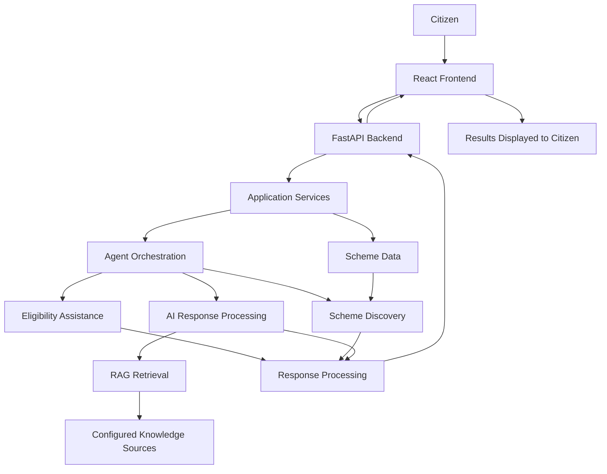

# 🏛️ IntelliGov AI
### PROTOTYPE LINK : https://intelligov-ai-5hpo-three.vercel.app/

### AI-Powered Government Scheme Discovery and Citizen Assistance Platform

IntelliGov AI is an AI-powered citizen assistance platform designed to help Indian citizens discover government schemes and understand potential eligibility through a unified interface.

The project combines a React frontend, FastAPI backend, Retrieval-Augmented Generation (RAG), and multi-agent architecture to support scheme discovery, eligibility assistance, and personalized recommendations.

> **Project Status:** Hackathon prototype. The project documents an 18-agent architecture, with seven agents having working logic and eleven additional agents represented by stub implementations. AI integrations may use mock services or fallback responses depending on the configuration.

---

## 📑 Table of Contents

- [Project Overview](#-project-overview)
- [Problem Statement](#-problem-statement)
- [Our Solution](#-our-solution)
- [Objectives](#-objectives)
- [Key Features](#-key-features)
- [System Architecture](#-system-architecture)
- [Technology Stack](#-technology-stack)
- [AI Agent Architecture](#-ai-agent-architecture)
- [Project Structure](#-project-structure)
- [Installation and Setup](#-installation-and-setup)
- [Environment Configuration](#-environment-configuration)
- [API Documentation](#-api-documentation)
- [Testing](#-testing)
- [Current Limitations](#️-current-limitations)
- [Future Scope](#-future-scope)
- [Contributing](#-contributing)
- [License](#-license)
- [Acknowledgements](#-acknowledgements)

---

## 🌐 Project Overview

Government schemes, scholarships, and other public opportunities can be difficult to discover because information is distributed across different departments and portals.

IntelliGov AI aims to make this information easier to explore by providing a centralized interface where citizens can ask questions, search for schemes, and understand eligibility requirements.

### Project Scope

- Citizen-facing web interface.
- FastAPI backend for application services.
- Scheme discovery and search.
- Profile-based eligibility assistance.
- AI chat interface for citizen queries.
- Retrieval-Augmented Generation (RAG) for retrieving relevant information from configured knowledge sources.
- Multi-agent architecture for organizing application logic.
- Explainable recommendations based on available information.

---

## ❗ Problem Statement

Citizens often face difficulties finding government schemes that match their circumstances. Eligibility criteria, documentation requirements, benefits, and application procedures may be spread across multiple sources.

This can make it difficult to identify suitable opportunities and understand the next steps.

IntelliGov AI addresses this problem by bringing scheme discovery and eligibility assistance into a single, accessible platform.

---

## 💡 Our Solution

IntelliGov AI provides a unified platform that helps users explore relevant government opportunities and understand potential eligibility.

The application combines a web interface with backend APIs and AI-assisted processing. Depending on the available implementation and configuration, the platform retrieves scheme information, processes user queries, and presents relevant results.

The platform is intended to assist citizens in understanding opportunities; it does not replace official government eligibility decisions or application procedures.

---

## 🎯 Objectives

- Simplify government scheme discovery.
- Help citizens understand eligibility requirements.
- Provide a centralized interface for government opportunity information.
- Use AI-assisted query processing and information retrieval.
- Organize application logic through a multi-agent architecture.
- Improve the accessibility and explainability of scheme information.
- Establish a foundation for future integrations with verified data sources.

---

## ✨ Key Features

### 1. Scheme Discovery

Explore government schemes using the information available in the configured dataset.

### 2. Eligibility Assistance

Evaluate user-provided information against the eligibility rules implemented by the application.

### 3. AI Chat Interface

Ask questions about government schemes and related opportunities through the application's chat interface.

### 4. RAG-Based Retrieval

Retrieve relevant information from configured knowledge sources to support AI-assisted responses.

### 5. Multi-Agent Architecture

Organize query processing and specialized application tasks through an agent-based design.

### 6. Explainability

Support clearer explanations of recommendations and eligibility results where the required logic and information are implemented.

> Feature availability depends on the current implementation, configured services, and available data sources.

---

## 🏗️ System Architecture

IntelliGov AI can be understood through the following logical layers:

1. **Presentation Layer:** React-based user interface.
2. **API Layer:** FastAPI backend and application endpoints.
3. **Application and Agent Layer:** Query processing, eligibility logic, and agent orchestration.
4. **Knowledge Layer:** Scheme datasets and configured retrieval components.
5. **Integration Layer:** AI model integrations, mock services, and external services where configured.

### Architecture Diagram



*The diagram represents the logical application flow. Actual execution depends on the implemented backend routes, agent logic, and service configuration.*

---

## 🛠️ Technology Stack

| Component | Technology |
|---|---|
| Frontend | React.js |
| Frontend Build Tool | Vite |
| Backend Framework | FastAPI |
| Programming Language | Python |
| API Communication | REST APIs |
| Data Validation | Pydantic, where configured |
| Retrieval-Augmented Generation | RAG |
| Embeddings | Sentence Transformers, where configured |
| Vector Store | ChromaDB, where configured |
| AI Integration | IBM Granite-compatible integration or mock/fallback services, depending on configuration |
| Version Control | Git and GitHub |
| Testing | Commands and test tools configured in the repository |

---

## 🤖 AI Agent Architecture

The project documents an architecture of 18 specialized agents.

Seven agents are described as having working logic, while eleven are represented by stub implementations. A stub indicates an extension point and should not be interpreted as a fully operational AI capability.

| Agent | Responsibility | Status |
|---|---|---|
| Master Orchestrator | Coordinates agent execution | Working logic |
| Intent Detection | Identifies query intent | Working logic |
| Citizen Digital Twin | Handles citizen profile representation | Working logic |
| Eligibility Verification | Evaluates eligibility | Working logic |
| Opportunity Discovery | Retrieves relevant opportunities | Working logic |
| Recommendation | Supports recommendation processing | Working logic |
| Explainable AI | Supports explanation generation | Working logic |
| Document Verification | Document validation | Stub |
| Policy Explanation | Policy information simplification | Stub |
| Career Opportunity | Career-related discovery | Stub |
| Future Eligibility Prediction | Future eligibility scenarios | Stub |
| Opportunity Loss Detector | Missed opportunity detection | Stub |
| Counterfactual AI | What-if eligibility scenarios | Stub |
| Debate and Consensus | Recommendation conflict resolution | Stub |
| Notification | Notification operations | Stub |
| Memory | Extended memory operations | Stub |
| Crawler | Data ingestion operations | Stub |
| Knowledge Graph Update | Knowledge graph update operations | Stub |

---

## 📁 Project Structure

The following is a high-level representation of the repository. Some folders or files may differ in the current branch.

```text
intelligov-ai/
├── README.md
├── README_ADDITION.md
├── LICENSE
├── CONTRIBUTING.md
├── backend/
│   ├── main.py
│   ├── requirements.txt
│   ├── API_DOCUMENTATION.md
│   ├── api/
│   ├── agents/
│   ├── services/
│   ├── core/
│   ├── models/
│   └── tests/
├── frontend/
│   ├── package.json
│   ├── vite.config.js
│   ├── index.html
│   └── src/
├── Government_Schemes.json
├── docs/
└── docker-compose.yml
```

---

## 🚀 Installation and Setup

### Prerequisites

Install the following tools:

- Python version supported by the backend dependencies.
- Node.js and npm.
- Git.
- Optional: Docker, if the current repository includes a working Docker configuration.

### 1. Clone the Repository

```bash
git clone https://github.com/Chhavi24184/intelligov-ai.git
cd intelligov-ai
```

### 2. Set Up the Backend

From the project root, create a virtual environment:

```powershell
python -m venv backend/venv
```

Activate it in Windows PowerShell:

```powershell
.\backend\venv\Scripts\Activate.ps1
```

Move into the backend directory:

```powershell
cd backend
```

Install the dependencies:

```bash
pip install -r requirements.txt
```

Start the FastAPI server:

```bash
uvicorn main:app --reload --port 8000
```

The backend address is:

`http://localhost:8000`

The interactive API documentation is:

`http://localhost:8000/docs`

### 3. Set Up the Frontend

Open a separate terminal at the project root and run:

```bash
cd frontend
npm install
```

List the available scripts:

```bash
npm run
```

Run the development script configured in `frontend/package.json`. For example, if the script is named `dev`:

```bash
npm run dev
```

Open the local URL displayed in the terminal. Vite commonly uses `http://localhost:5173`.

### 4. Docker Setup (Optional)

If Docker Compose is configured for the current version of the project, run this command from the directory containing `docker-compose.yml`:

```bash
docker compose up --build
```

Follow the terminal output to verify service startup and identify the configured URLs.

---

## 🔐 Environment Configuration

Check the repository for `.env.example` and the backend configuration files to identify the environment variables required by the current implementation.

If `backend/.env.example` exists, create a local environment file in PowerShell:

```powershell
Copy-Item backend/.env.example backend/.env
```

If you are already inside the `backend` directory, use:

```powershell
Copy-Item .env.example .env
```

Update the local `.env` file with the required configuration values.

**Security guidelines:**

- Never commit API keys, passwords, tokens, or other secrets.
- Do not publish a populated `.env` file.
- Use the exact environment variable names expected by the application.
- Keep example configuration values as safe placeholders.

---

## 🔌 API Documentation

Backend API documentation is maintained separately from this README.

- **API Documentation:** [`backend/API_DOCUMENTATION.md`](backend/API_DOCUMENTATION.md)
- **Swagger UI:** `http://localhost:8000/docs`
- **ReDoc:** `http://localhost:8000/redoc`

Start the backend before opening the local documentation URLs.

Swagger UI can be used to inspect registered endpoints, view request schemas, submit test requests, and review API responses.

The endpoints available at runtime depend on the routers registered by the backend. Refer to the documentation generated by the running application for the current API details.

---

## 🧪 Testing

Testing can be performed by running the backend, inspecting API endpoints, and checking frontend functionality.

### 1. Backend Startup and API Testing

From the project root, activate the virtual environment:

```powershell
.\backend\venv\Scripts\Activate.ps1
```

Start the backend:

```powershell
cd backend
uvicorn main:app --reload --port 8000
```

Open the API documentation:

```text
http://localhost:8000/docs
```

Use Swagger UI to test the available endpoints and inspect their responses.

### 2. Frontend Testing

Open a separate terminal from the project root:

```bash
cd frontend
npm run
```

Run the appropriate development command listed in `frontend/package.json`.

Verify that the interface loads and that the available pages and API integrations work as expected.

### 3. Automated Tests

If the repository contains a configured Pytest test suite, run it from the appropriate backend directory:

```bash
python -m pytest
```

Automated test coverage depends on the test files and dependencies available in the repository. This command does not create tests; it only runs tests that already exist.

### 4. Suggested Test Areas

- Backend health checks.
- Valid and invalid API requests.
- Scheme retrieval and search.
- Eligibility verification.
- Chat request validation.
- Agent execution and error handling.
- Frontend loading states.
- Frontend-to-backend API integration.

---

## ⚠️ Current Limitations

- Eleven documented agents are stub implementations rather than fully implemented agents.
- AI responses may use mock or fallback services depending on configuration.
- Recommendations depend on available scheme data and implemented eligibility rules.
- Live government portal integrations should not be assumed unless configured.
- Results are informational and do not guarantee official eligibility, application acceptance, or benefit disbursement.
- The project is a hackathon prototype and should not be treated as a production government service.

---

## 🔭 Future Scope

- Expand the functionality of the remaining agents.
- Integrate production AI model services where appropriate.
- Improve retrieval accuracy and source attribution.
- Connect verified and regularly updated government information sources.
- Improve eligibility explanations and validation.
- Strengthen automated testing and error handling.
- Improve accessibility and multilingual support.
- Add deployment, monitoring, and security improvements.

---

## 🤝 Contributing

Contributions and improvements are welcome.

1. Fork the repository.
2. Create a feature branch.
3. Make your changes.
4. Test the changes where applicable.
5. Commit with a descriptive message.
6. Open a pull request describing the changes.

Please review the project's contribution guidelines before submitting changes.

---

## 📄 License

Refer to the [`LICENSE`](LICENSE) file in the repository for the project's licensing terms.

---

## 🙏 Acknowledgements

- IBM SkillsBuild and the IBM AI technology ecosystem for the hackathon context.
- The maintainers of React, FastAPI, and other open-source tools used in the project.
- Public government information resources that inspired the scheme-discovery use case.

---

**IntelliGov AI — Making government opportunities easier to discover and understand.**
